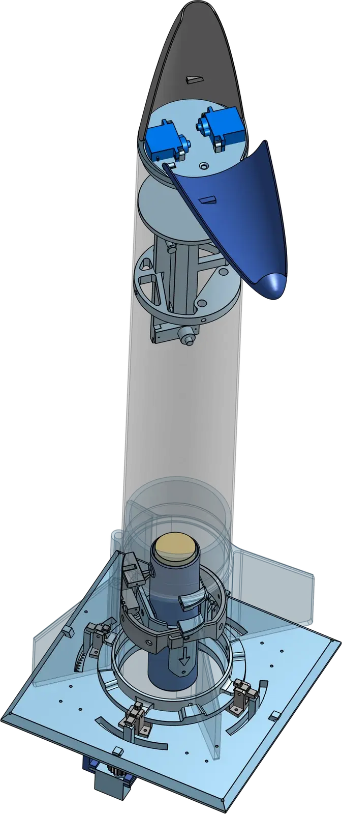
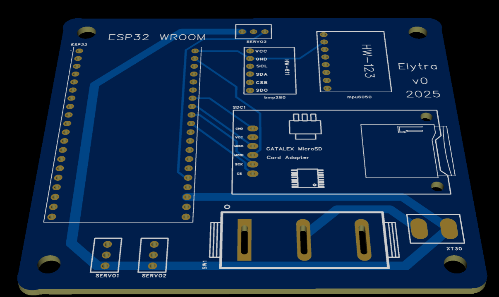

# Elytra

A flight computer for a half-kilogram solid-fuel hobby rocket with thrust vector control (TVC). It tracks the rocket's orientation and altitude, then steers the motor with two servos to keep it flying straight. The long-term goal is a self-landing rocket.

<p>
  
  
</p>

## What's on the board

- ESP32 microcontroller
- MPU6050 accelerometer and gyro for pitch, roll, and yaw
- BMP280 barometer for altitude
- Micro SD card for flight logs
- 3 servo headers: 2 for the TVC gimbal, 1 for the parachute
- 3S LiPo power with a 5V buck converter

## Firmware

Fuses the sensor data, runs a PID loop on pitch and roll, and turns the output into gimbal angles. It steps through flight states (armed, ascent, apogee, descent, landed) and logs everything to the SD card.

**Demo video:** https://youtu.be/cWIUwfU-qWE

## Tech

c++, platformio, arduino, kicad

## Structure

```
FIRMWARE/     flight software
PCB/          board design
PRODUCTION/   gerbers and the 3D printed mount
CAD/          mount design (STEP)
BOM.csv       parts list (about $46 beyond parts I already had)
Journal.md    build log
```
